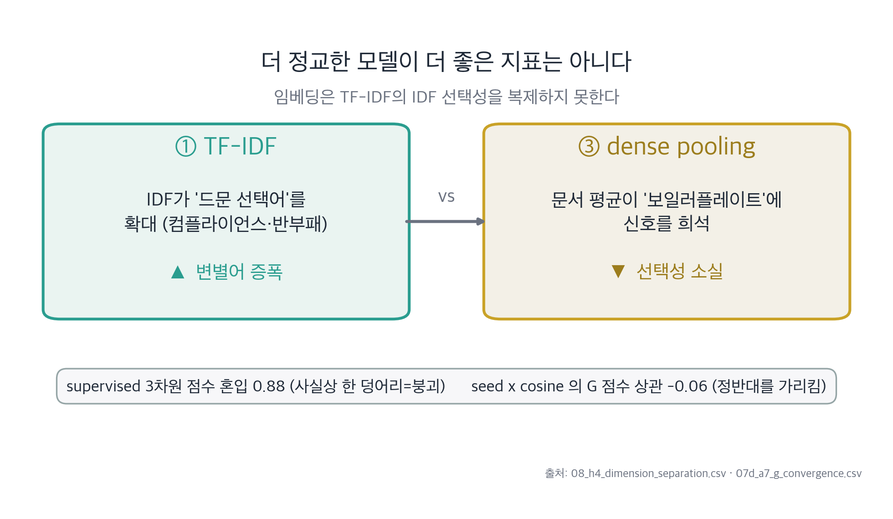
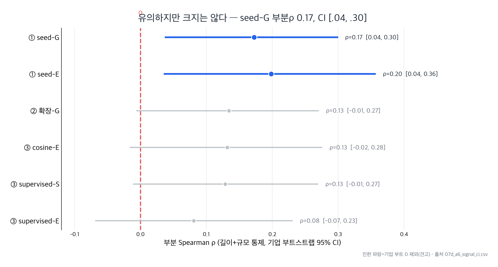

<!-- _class: lead -->

# Appendix

예상 질문 대비 보충 자료

---

## A1. 3트랙 측정치 상세

**같은 사업보고서를 세 방식으로 점수화해 동일 회귀식으로 공정 비교.**

| 트랙 | 방식 | 통제 후 생존 |
|---|---|---|
| ① seed TF-IDF | 30개 ESG 시드어 가중빈도 | **G 0.38\*\*** |
| ② fastText 확장 | 의미확장 사전 | 없음(노이즈↑) |
| ③ dense cosine | KURE-v1 임베딩 유사도 | 없음(E 시사·비강건) |
| ③ dense supervised | 프로브 분류기 | S 0.55\* (통합은 VIF 왜곡) |

- 통일 스펙: 순서형 로짓 · 기업 군집 SE · z표준화(ddof=0) · 단계적 통제
- 어느 차원도 과반(>2/4) 표현에서 재현 안 됨 → 신호는 차원특정이 아니라 단일 '공시 충실도' 요인에 가깝다

<em class="cap">[출처: 종합_기록.md · TF-IDF_기록.md · dense_기록.md]</em>

---

## A2. 다중공선성(VIF) 방어

**VIF 10은 절대 기준이 아니라 관례다 — 그리고 정규화로 처리 가능하다.**

- 측정 결과 대부분 VIF < 10 (관례적 임계)
- 통합 supervised S의 VIF 9.68은 공선성 왜곡 가능 → **해당 계수는 인용하지 않음**(매칭 또는 PC1 인용)
- 공선성 우려 시 **Lasso·Ridge·Elastic Net**으로 처리할 수 있다(**미실시** — 본 연구는 해당 계수 비인용으로 대응)
- "182cm는 큰 키인가?"처럼, 10이라는 숫자도 맥락 의존적 관례

<em class="cap">방어 핵심: 의심 변수는 인용하지 않거나 정규화로 상쇄, 임계 10의 절대성에 의존하지 않음.</em>

---

## A3. 측정타당성 — 임베딩 진단

**dense 실패는 앵커(기준문장) 탓이 아니라 풀링·분량 탓.**

- 화이트닝(ABTT) 후 차원분리는 오히려 양호 — 문장 검색은 정상
- G 앵커를 실질(DRIVER)만으로 교체해도 **완전통제 후 신호는 여전히 소멸**
- 상위문장 풀링(topk)에서 잠깐 살아나나 그 대부분이 **분량**(report_len과 +0.56~.65)
- 결론: 임베딩+풀링은 TF-IDF의 **IDF 선택성**(드문 변별어 증폭)을 복제하지 못함

<em class="cap">[출처: 왜_G만_남았나_기록.md H4 · 08b 앵커 교체 진단]</em>

---

## A4. 분량 착시 — '길게 쓰면 좋다'의 해체

**보고서 길이–등급 연관의 절반 이상이 사실 기업 규모를 경유한다.**

- log(문자수) raw Spearman **0.646** → 규모 통제 후 부분 **0.200** (≈ **53%가 규모 경유**)
- report_len(문장수) raw **0.634** → 부분 **0.224** (≈ **75%가 규모 경유**)
- 함의: **분량을 ESG 품질 프록시로 쓰지 말 것.** 쓰려면 규모 통제 잔차 분량만
- 선행연구(중국 10,021개 보고서)의 "길이가 ESG에 유의"를 통제로 정교하게 보정

<em class="cap">[출처: 종합_기록.md · 07d_a4]</em>

---

## A5. 신호 강건성 — 부트스트랩 신뢰구간

**G 신호는 통계적으로 0은 아니나, 신뢰구간이 0 근처까지 내려간다.**

- seed G 매칭 계수 0.38\*\*, 부분 ρ 0.17
- 기업 단위 부트스트랩 CI **[.04, .30]** — 하한이 0에 가깝다
- 이진 로짓·OLS 강건성 검정에서도 G만 일관 생존(나머지 비강건)
- **메타 생존표**: E 0/4 · S 1/4(dense supervised) · G 1/4(seed) → 어느 차원도 과반 재현 안 됨
- "유의 ≠ 중요" — 효과크기를 정직하게 보고

<em class="cap">[출처: TF-IDF_기록.md §12.2b · 07d_a6]</em>

---

## A6. 선행연구 (References)

**해외 텍스트–ESG 연구는 활발 / 국내 사업보고서·통제 설계는 우리가 조사한 바로는 제한적.**

- **등급 불일치**: Berg, Koelbel & Rigobon (2022) *Aggregate Confusion* — 평가사 상관 0.38~0.71, 불일치 최대 요인=측정방식
- **해외 텍스트–등급/주가**: Ignatov (2023, 10-K 톤–주가) · Oehler & Neuss (연차보고서 어휘–등급) · Kimbrough et al. (2022, 긍정 톤–등급 불일치)
- **추가 정리(차별성 문서)**: 관련 연구 다수 — 서지 확정 후 인용 *(발표 중 개별 저자명 단정 금지)*

<em class="cap">차별점 3겹: (a) 한국 사업보고서 이식 · (b) 규모·분량 단계통제 · (c) 복수 측정치 측정타당성.</em>

---

## A7. KCGS 통합등급의 G 쏠림 구조

**"통합이 G라서 G만 산 거 아니냐" — 증폭요인이지 근본원인이 아니다.**

- 통합등급 분해 가중: **G .92 ≫ S .44 > E .38** (corr(G, 통합) .93)
- 그러나 **분리한 g등급만**을 종속변수로 써도 **G만 생존**(0.38\*\*)
- 통합구조를 걷어내도 결과 동일 → G쏠림은 "통합에서 G가 두드러지는" 이유일 뿐, "왜 G만 사느냐"의 답은 선택적 어휘(H2)

<em class="cap">[출처: 08_h1_esg_decomposition.csv · 08_h1_fullcontrol_coef_3x4.csv · 왜_G만_남았나_기록.md §1]</em>

---

## A8. max_df 민감도 — "컷 때문에 G 만든 거 아니냐"

**컷오프를 풀어 G사전이 2배, raw 점수가 완전히 달라져도 통제 후 G는 더 강해진다.**

- max_df 0.95 → 1.0: G vocab **11 → 22개**, raw 점수 상관 ≈ 0 (사실상 다른 점수)
- 그래도 완전통제 후 G 계수 **0.38\*\* → 0.51\*\***, E·S는 여전히 비유의
- 이사회·사외이사·주주는 >95% 문서에 나오는 형식어라 0.95 컷에서 제거됨 — 컷은 신호를 *만드는* 게 아니라 점수를 해석 가능하게 정리할 뿐

<em class="cap">[출처: TF-IDF_기록.md §14 — 2026-06-01 max_df=1.0 재실행 검증]</em>

---

## A9. seed 사전 출처·구성 — "사전이 주관적 아니냐"

**30개 시드는 확립된 ESG 프레임워크 기반, E/S/G 동일 규칙, 결과 보고 안 건드림.**

- E/S/G 각 10개 = 30개. 출처: **Bloomberg · Refinitiv · MSCI KLD · Guiso · Bao** 등
- vocab 매칭: E 20 · S 14 · G 11개 (max_df 0.95 후)
- 핵심: 사전을 *결과 보고 손대지 않은* 비대칭에서 G만 생존 → 그 자체가 신뢰성 근거(손대면 아무 차원이나 유의하게 만들 수 있음)

<em class="cap">[출처: data/raw/seed_dictionary.csv · TF-IDF_기록.md §13]</em>

---

## A10. 잔차 진단의 한계 — 시사점 B(슬10) 정직성

**통제 대비 저평가 후보는 짚히지만, 텍스트로는 구별되지 않는다.**

- 저평가 후보 vs 나머지: **등급만** 다름(diff −1.95, p=.0005)
- **분량 p=.59 · 규모 p=.97** — 후보가 "많이 쓴" 게 아니라 통제 대비 등급만 낮음
- **텍스트 9종 전부 p>.09** — 텍스트 점수로 후보를 가려내지 못함
- 함의: 잔차는 탐색적 *실사 트리거 후보*일 뿐, 특정 기업 그린워싱 단정 불가

<em class="cap">[출처: 07d_a2_group_compare.csv]</em>

---

## A11. 예상 Q&A (1) — 연구 · 데이터 · 방법론

**Q. "해외에서 이미 한 거 아닌가?"**
→ 맞다. 기여는 '최초'가 아니라 **이식·통제·측정타당성**. 해외 질문을 한국 사업보고서로 옮기고, 규모·분량을 제거해도 남는지 본 것.

**Q. "텍스트가 등급을 예측한다는 해외 결과와 모순 아닌가?"**
→ 모순이 아니라 **메커니즘 분해**. 통제 전 상관은 해외와 일치한다. 다만 그 상관의 **상당 부분이 규모·분량을 경유**함을 보인 것. 평가기관 오류 주장이 아니다.

**Q. "등급 불일치는 왜 중요한가?"**
→ Berg·Koelbel·Rigobon(2022): 평가사 상관 **0.38~0.71**, 불일치 최대 요인이 **측정방식**. 측정타당성 문제의 근거.

**Q. "표본 127개사는 너무 적지 않나?"**
→ 적다. 그래서 약신호를 부풀리지 않고 **기업 cluster SE·부트스트랩**으로 보수적으로 본다(효과크기·CI 항상 병기). 검정력 한계는 인정, 발전방향에서 패널 확대.

**Q. "분량을 통제하면 텍스트 신호까지 제거하는 것 아닌가?"** ★
→ 분량은 *글자수*만 통제하고 *내용 구성*은 남긴다. TF-IDF는 L2 정규화라 길이의 기계적 효과가 1차 차단되고, 분량 통제 후에도 seed-G가 **0.38\*\*** 남는 게 "길이 빼도 내용 신호 있다"는 증거.

<!-- speaker note: 연구질문·데이터·방법론에서 자주 나올 질문입니다. 해외 중복 우려엔 '이식과 통제'로, 모순 우려엔 '메커니즘 분해'로 답합니다. 표본·분량 우려는 보수적 추론(cluster SE·부트스트랩)과 L2 정규화로 답합니다. 핵심은 약신호를 부풀리지 않는 정직함입니다. -->

---

## A12. 예상 Q&A (2) — TF-IDF · dense · G · 해석

**Q. "max_df=0.95 때문에 G가 만들어진 거 아닌가?"** ★
→ 컷을 풀어 G사전 2배·raw 점수가 완전히 달라져도 통제 후 G는 **0.38 → 0.51\*\***. 컷은 신호를 만드는 게 아니라 정리할 뿐(A8).

**Q. "supervised dense는 왜 S가 나오나? G만 남았다며?"** ★
→ 지도 프로브에선 S가 강건(**0.55\***). 그래서 "G만"은 *seed TF-IDF 한정*. 단 supervised는 정답 본 *상한*(낙관편의), 통합 S_sup은 VIF 9.68로 인용 불가.

**Q. "측정법마다 결과가 다르면 결론이 불안정한 것 아닌가?"** ★
→ 그 불안정성이 약점이 아니라 *결론*이다. 강한 차원신호면 표현이 달라도 같은 차원이 살아야 하는데 그렇지 않음 = 단일 공시충실도 요인(슬6).

**Q. "G 신호는 실제 지배구조 성과인가, 공시 언어인가?"** ★
→ 공시 언어다. 윤리·준법을 *더 공시한* 기업을 잡은 것이지 *더 잘한* 기업이 아님. cheap-talk 배제 못 함 → 성과 대체가 아니라 보조 렌즈.

**Q. "통합등급이 G에 치우쳐서 그런 것 아닌가?"** ★
→ 통합이 G에 실린 건 사실(β.92)이나 증폭요인. *분리 g등급*만 써도 G만 생존(**0.38\*\***) → 근본원인은 선택적 어휘(A7).

<!-- speaker note: 가장 날카로운 다섯 질문입니다. max_df엔 강건(A8), supervised S는 seed 한정의 반례이자 상한, 측정 불안정은 그 자체가 메타발견, G는 성과가 아니라 공시 언어, G쏠림은 분리등급에서도 동일이라 증폭요인일 뿐입니다. 일관되게 '약신호·연관·seed 한정'을 지키는 게 핵심입니다. -->
